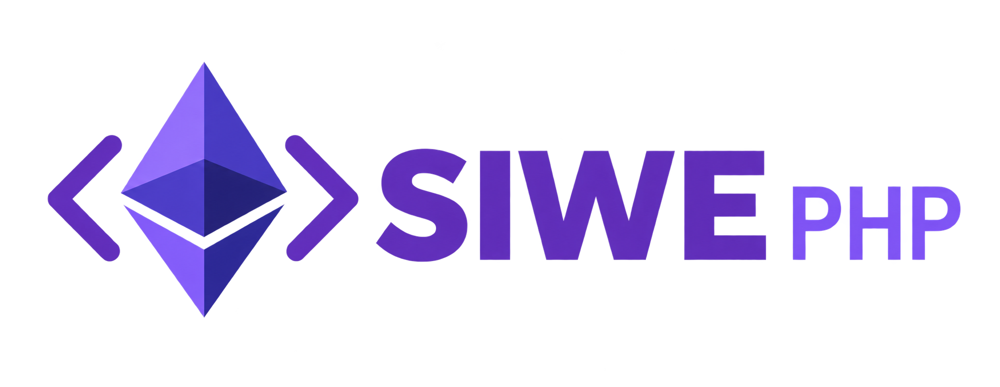

# SIWE PHP

<p align="center">
  
</p>

[](https://github.com/iltumio/siwe-php/actions/workflows/tests.yml)
[](https://packagist.org/packages/iltumio/siwe-php)
[](https://packagist.org/packages/iltumio/siwe-php)
[](composer.json)
[](LICENSE)

Sign-In with Ethereum (SIWE) message generation, parsing and signature verification in PHP.

## Requirements

PHP 8.3 or later, with the GMP, mbstring, ctype and JSON extensions.

## Install

```bash
composer require iltumio/siwe-php
```

## Generate a message

```php
use Iltumio\SiwePhp\SiweMessage;

$message = new SiweMessage([
    'domain' => 'example.com',
    'address' => '0xC02aaA39b223FE8D0A0e5C4F27eAD9083C756Cc2',
    'uri' => 'https://example.com/login',
    'version' => '1',
    'chainId' => 1,
]);

// A cryptographically random alphanumeric nonce is generated when omitted.
// Issued At is populated when the message is first serialized.
$signableMessage = $message->prepareMessage();
```

Store the nonce and message for the login attempt before requesting the wallet signature.

## Parse and verify

```php
$message = new SiweMessage($signedMessage);
$result = $message->verify([
    'signature' => $signature,
    'domain' => 'example.com',
    'nonce' => $storedNonce,
], [
    'suppressExceptions' => true,
    'providerUrl' => $rpcUrl,
])->wait();

if ($result['success']) {
    // Authenticate the address and consume the stored nonce to prevent replay.
} else {
    $reason = $result['error']->getMessage();
}
```

Verification returns a Guzzle promise. With `suppressExceptions` enabled, failures
resolve to `success: false`, `data` and `error`; otherwise the promise is rejected.
Bind verification to your expected domain and stored nonce. Optional `time` accepts
an RFC 3339 timestamp for deterministic verification; production requests normally
use the current time.

EOA signatures are verified locally. Contract wallets use EIP-1271 `eth_call` via
Guzzle, with bounded HTTP timeouts. Supply an HTTP(S) RPC endpoint for the message's
chain. The existing default provider applies only to chain ID 1; other chains
require an explicit endpoint. Pass `providerUrl => ''` to disable RPC verification.
RPC errors, reverted calls and malformed responses fail verification.

Messages with malformed dates, non-alphanumeric nonces, line breaks in fields,
duplicate fields or trailing data are rejected. Resources are preserved when parsing.

## Development

```bash
composer install
composer test
composer audit
```

The default suite is independent of a live Ethereum provider. To include the
mainnet contract-wallet integration fixtures:

```bash
SIWE_RPC_URL=https://your-mainnet-rpc.example ./run-tests.sh
```

## Disclaimer

This library is **released as is** and has not undergone any formal security audits.

## Credits

A PHP port of [SIWE](https://github.com/spruceid/siwe). See [login.xyz](https://login.xyz).

Made with ❤️ by Manuel Tumiati — [iltumio.eth.limo](https://iltumio.eth.limo).
